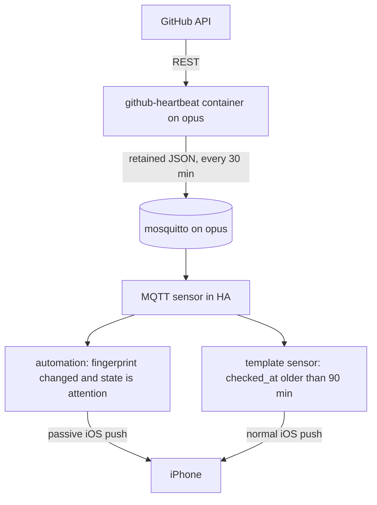

# GitHub dependency heartbeat → Home Assistant

## Status and ownership

This file is a handover document and design rationale for an implementation that now exists in this repository, except the deployment itself: the image has not been published and the container has not been run on `opus` yet. The GitHub-side work listed under "What changed on 2026-10-24" is live.

The implementation belongs in **`uhlig-it/infrastructure`**, and this file lives at `docs/github-heartbeat.md` in that repository, next to `smoke-detection-plan.md`. There is no separate "Home Assistant configuration repository": `/opt/homeassistant` on `opus` is partly Ansible-managed (`roles/homeassistant`) and partly UI-managed, and the Ansible vault in `uhlig-it/infrastructure` is the single source of truth for secrets.

This revision supersedes the earlier `command_line`-sensor design. The check now runs as its own container on `opus` and publishes its verdict over MQTT; Home Assistant only turns that verdict into a notification.

## Why this exists (background)

Steffen's dependency automation used to notify by email for every event: a Renovate or Dependabot pull request opened, tested and merged itself, and GitHub still sent email for each step. That is noise, because a PR that resolves itself required no human action.

The agreed model is pull-based instead of push-based:

- Subscribe to **decisions**, not events. Repositories are watched at "Participating and @mentions" only, so review requests, assignments and @mentions still notify, while bot PRs do not.
- Treat the bot as a **reconciliation loop**: desired state is "dependencies current, CI green". Steps of the loop are not news. Only failure to converge is news.
- Alert on **symptoms that need a human**, never on events.

The consequence, and the reason this plan exists: silence is now ambiguous. A PR that cannot auto-merge announces nothing, and a stopped Renovate app looks exactly like a quiet week. A local heartbeat script was written to resolve that ambiguity, but it only runs when the Mac is awake. Home Assistant runs continuously, can reach the GitHub API, and can push to a phone, so it is the right host for the decision and the notification.

## Current state as of 2026-10-24

### Repositories covered

Fifteen use Renovate (the Mend-hosted app, `renovate[bot]`), five use Dependabot (`dependabot[bot]`).

Renovate:

- `suhlig/rostfacto`
- `suhlig/rustomato`
- `suhlig/sqlite-vault`
- `suhlig/euro-exchange-rates-resource`
- `suhlig/concourse-resource-go`
- `suhlig/fipe`
- `suhlig/gosmos`
- `uhlig-it/kehrkraft`
- `uhlig-it/shop-alarm`
- `uhlig-it/shorts`
- `uhlig-it/mqtt-gpio-binary-sensor`
- `uhlig-it/mqtt-router`
- `uhlig-it/mqtt-blink1`
- `uhlig-it/speedtest-exporter`
- `uhlig-it/tasmota-firmware-proxy`

Dependabot:

- `suhlig/concourse-rss-resource`
- `suhlig/httpspell`
- `suhlig/pandoc-include-filter`
- `suhlig/wordclock`
- `suhlig/revealing`

`suhlig/dspictl` is deliberately excluded: it is archived, so Renovate is disabled there.

### What changed on 2026-10-24

- Every `suhlig/*` and `uhlig-it/*` repository was unwatched (`DELETE /repos/{owner}/{repo}/subscription`), which is GitHub's "Participating and @mentions" state. The 30 third-party repositories still watched at all-activity were left alone deliberately.
- All fifteen Renovate configs now assign review-gated updates to `suhlig`:
  - `rostfacto`, `rustomato`, `mqtt-blink1`, `kehrkraft`: `assignees` added inside the existing rule that gates minor and major.
  - The other eleven: one appended rule with `matchUpdateTypes: ["major"]` and `assignees`, because those configs auto-merge minor updates and assigning minor would recreate the noise.
- A local heartbeat script exists at `suhlig/dotfiles` (commit `246f131`), path `common/bin/dependency-heartbeat`, installed as `~/bin/dependency-heartbeat` via GNU Stow. It is bash using `gh` and `jq`.

### What the heartbeat considers an exception

- Any open Dependabot PR. Dependabot auto-merge is not configured in these repositories, so these always need a human.
- A Renovate PR that is `CONFLICTING`, has a failing check (`FAILURE`, `ERROR`, `TIMED_OUT`, `ACTION_REQUIRED`, `CANCELLED`, `STARTUP_FAILURE`), or is older than `STUCK_DAYS` (default 7).
- An open Dependabot alert, where the repository has alerts enabled.
- No Renovate activity anywhere for `SILENT_DAYS` (default 21), measured as the freshest Dependency Dashboard `updated_at` across all repositories.
- Anything else is treated as in flight and stays silent.

Current findings at handover, for calibration:

- DONE `suhlig/concourse-rss-resource#391` — a Dependabot bump of aruba, four days old, repository has no CI and no automerge, so it will never resolve itself.
- `suhlig/wordclock` — three open Dependabot alerts.
- Everything else was in flight or clean.

## Decisions taken in this revision

1. **Packaging: sidecar container on `opus`.** The check leaves the HA container entirely. HA's Python environment is an implementation detail of the HA image, `gh` and `jq` are absent there, and anything written into `/opt/homeassistant` is uploaded to Backblaze B2 by the `home-assistant-backup-b2` role.
2. **Coupling: MQTT state, not the HA REST API.** The container publishes retained JSON to the local broker. HA reads it with an MQTT sensor. The container never holds an HA token and never calls `notify.mobile_app_*`.
3. **Notifications stay in HA**, as a package managed by `roles/homeassistant` (the same pattern as `smoke_detection.yaml.j2`), so they survive an HA rebuild.
4. **Token: Ansible vault plus a root-only file**, mounted read-only into the container. It never enters the HA config tree or its backups.
5. **Image: `ghcr.io/uhlig-it/github-heartbeat`, built from this repository**, pinned by version tag. Watchtower must not update it: the component that watches your automation should not change without review.
6. **Target device:** `notify.mobile_app_iphone_15_pro_steffen` (iOS), already the fleet's alert service (`homeassistant_smoke_notify_service`).
7. **Polling:** every 1800 seconds, matching the local script's practical cadence. Twenty repositories at roughly three API calls each is far inside the 5000 requests per hour limit.
8. **Dedupe:** a `fingerprint` field in the JSON, and an HA automation that triggers on that attribute. No `input_text` helper is needed.
9. **The monthly all-clear is replaced by a staleness alert.** If no heartbeat has arrived for 90 minutes, HA says so. That is the same guarantee with a much shorter latency; a monthly positive pulse becomes optional.
10. **Language:** keep bash + `gh` + `jq`. The image supplies the missing tools, so the tuned queries and classification rules are preserved instead of re-derived. Only the output assembly changes, because the contract is JSON.

## Goal

Run the exception check from `opus` on a schedule and push an iOS notification when something needs a human, so the information arrives even when the Mac is asleep or elsewhere — and so a dead check is itself announced.

## Non-goals

- Do not re-enable repository-level watch subscriptions.
- Do not notify about ordinary bot PR activity, successful merges, or CI results.
- Do not require the Mac to be online.
- Do not put GitHub credentials in the HA YAML, in the HA config directory, or on a container command line.

## Architecture



### Components

1. **Image** `ghcr.io/uhlig-it/github-heartbeat`: Alpine plus `bash`, `jq`, `github-cli`, `mosquitto-clients`, `ca-certificates`, and the heartbeat script.
2. **Service playbook** `playbooks/services/github-heartbeat.yml`, targeting `opus` only, with `network_mode: host` so the container reaches `127.0.0.1:1883`, and `restart_policy: always`.
3. **MQTT contract** on the local broker: one retained state topic and one availability topic.
4. **HA package** `roles/homeassistant/templates/packages/github_heartbeat.yaml.j2`: an MQTT sensor, a template binary sensor for staleness, and the notification automations.

### Why not inside the HA container

- `gh` and `jq` are absent, which forces a rewrite and a dependency on whatever Python libraries the HA image happens to ship.
- An HA upgrade can change that environment without warning, and the heartbeat would fail silently.
- A `command_line` sensor has no availability semantics: a crashed check is indistinguishable from a quiet week.
- The token would have to live in `/opt/homeassistant`, which the B2 backup role uploads.
- Logs and manual test runs are far easier with `docker logs` and `docker run --once` than inside HA.

## Data collection algorithm

Preserve the local script's semantics exactly; they were tuned to avoid false positives.

1. For each of the twenty repositories, list open pull requests with author, creation time, `mergeable` and the status check rollup. The implementation uses `gh pr list --json number,title,createdAt,url,author,mergeable,statusCheckRollup` per repository, which keeps the original `jq` classifier unchanged. A single GraphQL query per owner would be fewer calls, but twenty repositories are far inside the rate limit and the REST shape is already proven.
2. Classify each PR authored by `renovate[bot]` or `dependabot[bot]`:
   - author is Dependabot, therefore `needs you`;
   - else `mergeable == "CONFLICTING"`, therefore `conflict`;
   - else any check with a failing conclusion or state, therefore `checks failing`;
   - else age greater than `STUCK_DAYS`, therefore `stale`;
   - else ignore.
   - Ignore PRs from any other author entirely. The user browses human PRs himself; the heartbeat is about automation health.
3. For each repository, fetch open Dependabot alerts. Treat an error containing "disabled" as "no alerts configured" and stay silent; count any other error as `unreadable` so a genuine permission problem is visible.
4. Liveness: find the open issue titled `Dependency Dashboard` in each repository and take the maximum `updated_at`. If that maximum is older than `SILENT_DAYS`, report `silent`. Do **not** report per-repository staleness; see the pitfalls section.
5. **Deliberate divergence from the local script:** a repository whose PR listing fails is recorded in `errors` and makes the overall state `attention`. The bash script currently swallows that failure with `2>/dev/null || true`, which is exactly the blind spot this system exists to remove. A renamed repository, an expired token or a revoked organization approval must not look like "clean".

## MQTT contract

| Topic | Retained | Payload |
| --- | --- | --- |
| `github/heartbeat/state` | yes | the JSON object below |
| `github/heartbeat/status` | yes | `online` on start, `offline` on a clean shutdown |

Publishing a cycle:

```json
{
  "state": "attention",
  "checked": 20,
  "expected": 20,
  "checked_at": "2026-10-24T16:30:00Z",
  "fingerprint": "3b1c0f5e9a27",
  "needs": [
    {
      "repo": "suhlig/concourse-rss-resource",
      "number": 391,
      "reason": "needs you",
      "title": "Bump aruba from 2.4.1 to 3.0.1",
      "url": "https://github.com/suhlig/concourse-rss-resource/pull/391",
      "age_days": 4
    }
  ],
  "alerts": [
    { "repo": "suhlig/wordclock", "count": 3 }
  ],
  "silent": null,
  "unreadable": 0,
  "errors": []
}
```

Rules:

- `state` is `"attention"` when `needs`, `alerts`, `silent` or `errors` is non-empty, or when `checked != expected`; otherwise `"ok"`.
- `silent` becomes `{"since": "2026-10-03", "days": 21}` when triggered. When no Dependency Dashboard exists anywhere, it becomes `{"since": null, "days": null, "reason": "no Dependency Dashboard found in any repository; cannot tell whether Renovate runs"}`, which is also `attention`.
- `fingerprint` is a short hash over the canonical, sorted set of `repo#number:reason`, alert `repo:count`, `error repo` and the `silent.since` value. **Exclude ages, counts of pull requests and all timestamps** from the hash, or it changes on every run and defeats dedupe.
- `checked_at` is the UTC time the cycle finished.
- The script exits 0 when a cycle completed, whatever the verdict, and non-zero only on a configuration or startup error. Nothing consumes the exit code; the payload carries the decision.

## Container behaviour

- Long-running process with an internal loop, interval from `INTERVAL_SECONDS` (default `1800`); `--once` runs a single cycle and exits, for tests and manual checks.
- On each cycle, re-read the token from `GITHUB_TOKEN_FILE` and export it as `GH_TOKEN` for the `gh` subprocess. Token rotation then needs no restart.
- Publish `github/heartbeat/state` once per cycle, retained, even when the state is unchanged; HA's staleness check depends on it.
- Publish `online` to `github/heartbeat/status` on start and `offline` on `SIGTERM`. The status topic is best effort; a hard crash publishes nothing, which is why the staleness check is authoritative.
- Log one line per cycle to stdout: state, counts, duration. `docker logs github-heartbeat` is the primary diagnostic.
- Read the repository list from `REPOS`, a comma-separated environment variable, so a repository can be added without rebuilding the image.

## Auth and secrets

Fine-grained PAT, read-only, limited to the two owners:

- Metadata: read (mandatory).
- Pull requests: read.
- Issues: read (the Dependency Dashboard is an issue).
- Dependabot alerts: read.

For classic PATs, `repo` is what the subscription and pull request endpoints needed in practice; verify whether Dependabot alerts additionally require `security_events` before relying on a classic token. Note that `uhlig-it` may require organization approval for a fine-grained PAT. If approval is impractical, either drop the `uhlig-it` repositories or use a classic token; do not let the check silently lose half its coverage, which is why per-repository errors are part of the contract.

Storage:

- `vault_github_heartbeat_token` in `inventory/group_vars/all/secrets.yml`.
- Rendered by the playbook to `/opt/github-heartbeat/token`, `root:65534`, mode `0440`, with `no_log: true`, and mounted read-only at `/run/secrets/github-token`.
- MQTT credentials: add a `github-heartbeat` entry to `mosquitto_users` in `inventory/host_vars/opus/secrets.yml` (where every broker user lives), the same way `mic-detector` is provisioned, and select the password in the playbook with `selectattr('name', 'equalto', 'github-heartbeat')`.

## Scaffolded files

These exist in this repository now. This document is the rationale; the files are the source of truth.

- `images/github-heartbeat/heartbeat.sh` — the classifier, the JSON contract, the MQTT publisher and the `--once` mode.
- `images/github-heartbeat/test.sh` — network-free tests with a fake `gh` and `mosquitto_pub`: classification order, human/green PRs ignored, per-repository errors, alerts-enabled vs. disabled, the no-dashboard case and fingerprint stability.
- `images/github-heartbeat/Dockerfile` — Alpine plus `gh`, `jq` and `mosquitto-clients`, running as `65534:65534` with a writable home for `gh`.
- `.github/workflows/build-github-heartbeat.yml` — runs the tests, then builds `linux/amd64` and `linux/arm64` and publishes on `github-heartbeat-v*` tags only. Never `latest`.
- `playbooks/services/github-heartbeat.yml` — deploy to `opus`: token file, MQTT credentials, pinned image tag, repository list.
- `roles/homeassistant/templates/packages/github_heartbeat.yaml.j2` — the MQTT sensor, the stale binary sensor and the notification automations.
- `roles/homeassistant/tasks/main.yml` — templates that package, mirroring the smoke-detection task.
- `roles/homeassistant/defaults/main.yml` — `homeassistant_heartbeat_notify_service`, defaulting to the same iPhone as the smoke alerts.
- `playbooks/site.yml` — imports the service playbook.
- `inventory/group_vars/all/secrets.yml.example` — documents the token variable.

The image lives here rather than in a separate repository: it is an ops tool, not an application, and this keeps the image tag, the deployment and the HA package in one reviewable change. If you prefer the fleet's "app repo builds, infrastructure deploys" split, move `images/github-heartbeat/` to `uhlig-it/github-heartbeat` and point `github_heartbeat_image` at it; nothing else changes.

### Deployment notes

- The Alpine package name for the GitHub CLI is `github-cli`; the build fails loudly if a future Alpine release renames it.
- The container runs as `65534:65534`, so the token file is `root:65534` with mode `0440`. Docker maps numeric IDs straight through. Do not pass the token through an environment variable; that would expose it in `docker inspect`.
- The token is re-read every cycle, so rotating the PAT is a vault change plus a playbook run, not a container restart.
- Do not put this container under watchtower: the pinned version tag already prevents it, because watchtower would pull the same tag.
- Adding the `github-heartbeat` MQTT user requires the mosquitto role to regenerate the broker passwd file; run `ansible-playbook playbooks/machines/opus.yml --tags mosquitto` after the vault change.
- The HA package must be templated by the role, not edited in the UI, because an HA rebuild or a container restart would discard UI edits.
- The role templates the package but does not restart Home Assistant. Restart it (`docker restart homeassistant`) so the new MQTT sensor and automations are loaded; this matches the existing smoke-detection package, which also relies on the next restart.

## Notification policy

The package in `roles/homeassistant/templates/packages/github_heartbeat.yaml.j2` implements this policy:

- The `state` trigger on a specific attribute is what makes dedupe work: it fires only when the fingerprint changes, so an unchanged set of exceptions produces no second notification. A new exception appearing while the state stays `attention` still changes the fingerprint and still notifies.
- A trigger does not fire on HA startup, so restarting HA does not re-notify. The retained message means the sensor is correct immediately.
- `expire_after` is deliberately not used. With retained state it resets on every HA restart, so a dead container could look fresh. The template sensor compares `checked_at` against the clock instead, which is independent of HA restarts.
- iOS supports `tag` replacement, `thread-id` grouping and `interruption-level`; `passive` keeps routine dependency notices from lighting up the lock screen.
- `silent` gets a notification with a stable tag; repository read errors are aggregated into one summary notification, so an expired token does not produce one alert per repository.
- The optional monthly positive pulse is not implemented: the staleness automation already covers the dead-check case, so a periodic all-clear would be noise.

## Testing

1. `bash images/github-heartbeat/test.sh` — network-free, with a fake `gh` and `mosquitto_pub`. It asserts the classification order, that human and green PRs are ignored, the per-repository error path, alerts enabled vs. disabled, the no-dashboard case and fingerprint stability.
2. `docker run --rm --network host -v /opt/github-heartbeat/token:/run/secrets/github-token:ro -e GITHUB_TOKEN_FILE=/run/secrets/github-token -e REPOS=... -e MQTT_USER=... -e MQTT_PASSWORD=... ghcr.io/uhlig-it/github-heartbeat:v0.1.0 --once` on `opus`, and inspect the JSON with `jq`.
3. `mosquitto_sub -h 127.0.0.1 -u ... -P ... -v -t 'github/#'` while the container runs, to confirm both topics and the retained flag.
4. Set `STUCK_DAYS=0` and confirm `attention`, then confirm the iPhone shows exactly one notification per exception and that a second cycle with unchanged exceptions adds none.
5. Add one new exception (for example by temporarily adding a repository with an open Dependabot PR) and confirm a new notification arrives while the state stays `attention`.
6. `docker stop github-heartbeat`, wait 2 hours, and confirm the staleness notification.
7. Use a token without `Dependabot alerts` permission for one repository and confirm `unreadable` is counted without a false alarm; use a token with no access at all and confirm `errors` produces `attention`, not silence.

## Implementation status

Scaffolded in this revision: classifier and tests; image and build workflow; service playbook and `site.yml` import; HA package, role task and default variable; documented vault entries.

Remaining, in order:

1. Create the fine-grained PAT and add `vault_github_heartbeat_token` to `inventory/group_vars/all/secrets.yml`; add `github-heartbeat` to `mosquitto_users` in `inventory/host_vars/opus/secrets.yml`.
2. Run `ansible-playbook playbooks/machines/opus.yml --tags mosquitto` so the broker passwd file includes the new user.
3. Tag and push `github-heartbeat-v0.1.0`; confirm the workflow publishes `ghcr.io/uhlig-it/github-heartbeat:v0.1.0`.
4. Run `ansible-playbook playbooks/services/github-heartbeat.yml`.
5. Verify the retained state with `mosquitto_sub`, and that `sensor.github_dependency_heartbeat` shows `ok` or `attention` in Developer Tools → States.
6. Run `ansible-playbook playbooks/machines/opus.yml --tags homeassistant`, restart Home Assistant, then confirm the entities and automations exist.
7. Test the notifications through Developer Tools → Actions, then run the acceptance checks, including the stale-container case.

## Acceptance criteria

- With `STUCK_DAYS=0`, the sensor reports `attention` and one notification arrives naming each stuck PR.
- With the real settings, the sensor reports `attention` for `concourse-rss-resource#391` and the three `wordclock` alerts, and nothing else.
- No notification is produced by an ordinary Renovate PR that is opened, tested and merged unattended.
- Notification text includes repository, PR number, reason and age, and tapping it opens the PR.
- A second evaluation with unchanged exceptions does not produce a second notification.
- Stopping the container produces a staleness notification within two hours.
- An unreadable repository produces `errors` and `attention`, not silence.
- The check runs with the Mac powered off.
- The token exists only in the Ansible vault and in a `root:65534` `0440` file on `opus`; it is absent from `/opt/homeassistant` and from the B2 backups.

## Known pitfalls

- **The Dependency Dashboard is only rewritten when something changes.** Renovate updated `rostfacto`'s dashboard at 12:41 on 2026-10-24, exactly when a config commit was pushed, while `mqtt-blink1`'s was 40 days old with nothing to update. Per-repository staleness therefore produces false alarms; only the global maximum is meaningful.
- **Many repositories have Dependabot alerts disabled**, which returns an HTTP error containing "disabled". Do not report that as a permission problem.
- **`wc -l` undercounts** a command substitution result because the trailing newline is stripped. Count in the JSON layer instead, for example `jq 'add | length'` or `len(...)`.
- **Do not include ages in the fingerprint.** `age_days` changes daily, which would notify every day for the same stuck PR.
- **Retained state plus `expire_after` is a footgun.** HA resets the timer whenever it re-subscribes, including after its own restart. Use the `checked_at` comparison for staleness.
- **The `status` topic is best effort.** `mosquitto_pub` is a short-lived publisher, so there is no broker last will: a hard crash or OOM kill publishes nothing. Publish `offline` on `SIGTERM` for clean stops, but treat the `checked_at` staleness sensor as the authoritative liveness signal.
- **Ansible will not restart the container when only the mounted token file changes.** Reading the token per cycle avoids the problem entirely; if you switch to an environment variable, the changed environment makes `docker_container` restart it.
- **Rulesets and branch protection** on `rustomato` and `kehrkraft` reject force-pushes, which is why two repositories carry an extra cleanup commit in their history. This is unrelated to the heartbeat but explains the git log.
- **Rate limits** are comfortable at twenty repositories, but avoid an interval below a few minutes, and avoid per-PR REST calls; one `gh pr list` per repository is enough.
- **The `uhlig-it` fine-grained PAT may need organization approval.** Until it is granted, those repositories must either be dropped explicitly or surface as `errors`; they must not disappear from `checked` silently.
- **Alpine's `github-cli` package may lag upstream.** Pin the Alpine release in the Dockerfile and rebuild deliberately; do not tack `latest` onto the image tag.

## Alternatives considered

1. **`command_line` sensor inside the HA container.** The original design. Rejected: it requires a rewrite because `gh`/`jq` are absent, couples the check to HA's Python environment, puts the PAT in the B2-backed config directory, and provides no availability or staleness signal.
2. **Systemd timer and script on `opus`.** The `mic-smoke-detector` pattern. Simpler than an image, but it installs `gh` and `jq` on the host, gives no dependency isolation, and still needs a wrapper to publish MQTT.
3. **Container that calls the HA notify service over the REST API.** Rejected: it needs a long-lived HA token in a second place, duplicates tags, threads and channels, and makes notification wording a code change instead of a YAML change.
4. **GitHub Actions cron plus webhook.** Rejected: GitHub disables scheduled workflows in inactive repositories after 60 days, which is exactly the dead-automation failure this system exists to detect.
5. **`rest` sensors only, no script.** The search API cannot express "mergeable, checks failing, older than N days" per PR, so classification would move into templates and become hard to read.
6. **Watchtower tracking `latest`.** Rejected: silent updates to the component that watches everything else defeat the purpose.

## References

- Local script, authoritative for semantics: `suhlig/dotfiles`, commit `246f131`, path `common/bin/dependency-heartbeat`; installed as `~/bin/dependency-heartbeat`.
- Existing HA package pattern: `roles/homeassistant/templates/packages/smoke_detection.yaml.j2` and `docs/smoke-detection-plan.md`.
- Existing container pattern: `roles/shop-alarm/tasks/main.yml` and `playbooks/services/shop-alarm.yml`.
- MQTT credential pattern: `mosquitto_users` in the vault, as used by `playbooks/services/mic-smoke-detector.yml`.
- Renovate documentation for `assignees`, `matchUpdateTypes`, `minimumReleaseAge`, `automergeType` and `dependencyDashboardApproval`.
- GitHub REST: `DELETE /repos/{owner}/{repo}/subscription` (unwatch, which equals participating and @mentions) and `GET /repos/{owner}/{repo}/dependabot/alerts?state=open`.
- GitHub Docs: "Configuring notifications" for the watch levels and for the fact that only GitHub Mobile push has a schedule, not email.
- Home Assistant: MQTT sensor (`json_attributes_topic`, `availability_topic`), template binary sensor, mobile app notification `tag`, `thread-id` and `interruption-level`.
