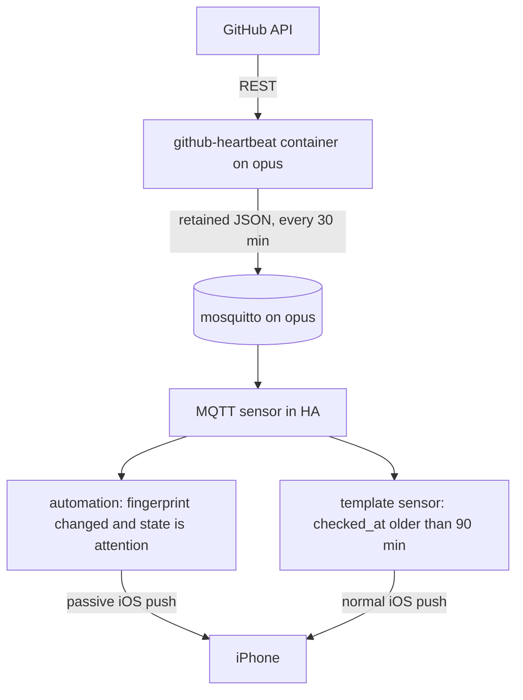

# GitHub dependency heartbeat → Home Assistant

## Status

Live since 2026-10-24. The check runs as the `github-heartbeat` container on `opus` (image `ghcr.io/uhlig-it/github-heartbeat:v0.1.1`), publishes one retained JSON verdict to `github/heartbeat/state` on the local broker every 30 minutes, and Home Assistant turns a changed verdict into iOS notifications.

First live verdict (2026-10-24T16:07:12Z): `attention`, `checked=20/20`, no pull request needed a human, and `suhlig/wordclock` had three open Dependabot alerts. The notification path was exercised through Home Assistant and confirmed working.

The implementation lives in **`uhlig-it/infrastructure`**. There is no separate "Home Assistant configuration repository": `/opt/homeassistant` on `opus` is partly Ansible-managed (`roles/homeassistant`) and partly UI-managed, and the Ansible vault in `uhlig-it/infrastructure` is the single source of truth for secrets.

## Why this exists

Dependency automation used to notify by email for every event: a Renovate or Dependabot pull request opened, tested and merged itself, and GitHub still sent email for each step. That is noise, because a PR that resolves itself required no human action.

The model is pull-based instead of push-based:

- Subscribe to **decisions**, not events. Repositories are watched at "Participating and @mentions" only, so review requests, assignments and @mentions still notify, while bot PRs do not.
- Treat the bot as a **reconciliation loop**: desired state is "dependencies current, CI green". Steps of the loop are not news. Only failure to converge is news.
- Alert on **symptoms that need a human**, never on events.

The consequence is that silence is ambiguous: a PR that cannot auto-merge announces nothing, and a stopped Renovate app looks exactly like a quiet week. The heartbeat resolves that ambiguity. It runs on the machine that already runs Home Assistant, so it does not depend on the Mac being awake, and a dead check is itself announced.

## What counts as an exception

- Any open Dependabot PR. Dependabot auto-merge is not configured in these repositories, so these always need a human.
- A Renovate PR that is `CONFLICTING`, has a failing check (`FAILURE`, `ERROR`, `TIMED_OUT`, `ACTION_REQUIRED`, `CANCELLED`, `STARTUP_FAILURE`), or is older than `STUCK_DAYS` (default 7).
- An open Dependabot alert, where the repository has alerts enabled.
- No Renovate activity anywhere for `SILENT_DAYS` (default 21), measured as the freshest Dependency Dashboard `updated_at` across all repositories.
- A repository that could not be read at all. This is a deliberate divergence from the local script, which swallowed that failure. A renamed repository, an expired token or a revoked organization approval must not look like "clean".

Anything else is treated as in flight and stays silent. Human-authored PRs are ignored entirely: the heartbeat is about automation health, not a second inbox.

## Repositories covered

Fifteen use Renovate (the Mend-hosted app, `renovate[bot]`), five use Dependabot (`dependabot[bot]`).

Renovate:

- `suhlig/rostfacto`
- `suhlig/rustomato`
- `suhlig/sqlite-vault`
- `suhlig/euro-exchange-rates-resource`
- `suhlig/concourse-resource-go`
- `suhlig/fipe`
- `suhlig/gosmos`
- `uhlig-it/kehrkraft`
- `uhlig-it/shop-alarm`
- `uhlig-it/shorts`
- `uhlig-it/mqtt-gpio-binary-sensor`
- `uhlig-it/mqtt-router`
- `uhlig-it/mqtt-blink1`
- `uhlig-it/speedtest-exporter`
- `uhlig-it/tasmota-firmware-proxy`

Dependabot:

- `suhlig/concourse-rss-resource`
- `suhlig/httpspell`
- `suhlig/pandoc-include-filter`
- `suhlig/wordclock`
- `suhlig/revealing`

`suhlig/dspictl` is deliberately excluded: it is archived, so Renovate is disabled there.

## Architecture



### Components

1. **Image** `ghcr.io/uhlig-it/github-heartbeat`: Alpine plus `bash`, `jq`, `github-cli`, `mosquitto-clients` and `ca-certificates`, running as `65534:65534`.
2. **Service playbook** `playbooks/services/github-heartbeat.yml`, targeting `opus` only, with `network_mode: host` so the container reaches `127.0.0.1:1883`, and `restart_policy: always`.
3. **MQTT contract** on the local broker: one retained state topic and one availability topic.
4. **HA package** `roles/homeassistant/templates/packages/github_heartbeat.yaml.j2`: an MQTT sensor, a template binary sensor for staleness, and the notification automations.

### Why not inside the HA container

- `gh` and `jq` are absent, which would force a rewrite and a dependency on whatever Python libraries the HA image happens to ship.
- An HA upgrade can change that environment without warning, and the heartbeat would fail silently.
- A `command_line` sensor has no availability semantics: a crashed check is indistinguishable from a quiet week.
- The token would have to live in `/opt/homeassistant`, which the B2 backup role uploads.
- Logs and manual runs are far easier with `docker logs` and `--once` than inside HA.

## How the check works

The classifier is the tuned `gh` + `jq` logic from the local script, so the semantics did not change when it moved into the container.

1. For each repository, list open pull requests with author, creation time, `mergeable` and the status check rollup, using `gh pr list --json number,title,createdAt,url,author,mergeable,statusCheckRollup`. One REST call per repository is comfortably inside the rate limit.
2. Classify each PR authored by `renovate[bot]` or `dependabot[bot]`:
   - author is Dependabot, therefore `needs you`;
   - else `mergeable == "CONFLICTING"`, therefore `conflict`;
   - else any check with a failing conclusion or state, therefore `checks failing`;
   - else age greater than `STUCK_DAYS`, therefore `stale`;
   - else ignore.
3. For each repository, fetch open Dependabot alerts. An error containing "disabled" means the repository has no alerts configured and is silent; any other error increments `unreadable`.
4. Liveness: find the open issue titled `Dependency Dashboard` in each repository and take the maximum `updated_at`. If that maximum is older than `SILENT_DAYS`, report `silent`. Per-repository staleness is not reported; see the pitfalls.
5. A repository whose pull request listing fails is recorded in `errors`, which makes the overall state `attention`.

## MQTT contract

| Topic | Retained | Payload |
| --- | --- | --- |
| `github/heartbeat/state` | yes | the JSON object below |
| `github/heartbeat/status` | yes | `online` on start, `offline` on a clean shutdown |

The live payload at the first check:

```json
{
  "state": "attention",
  "checked": 20,
  "expected": 20,
  "checked_at": "2026-10-24T16:07:12Z",
  "fingerprint": "c9acd6a7fae2",
  "needs": [],
  "alerts": [
    { "repo": "suhlig/wordclock", "count": 3 }
  ],
  "silent": null,
  "unreadable": 0,
  "errors": []
}
```

A `needs` entry looks like this:

```json
{
  "repo": "suhlig/concourse-rss-resource",
  "number": 391,
  "reason": "needs you",
  "title": "Bump aruba from 2.4.1 to 3.0.1",
  "url": "https://github.com/suhlig/concourse-rss-resource/pull/391",
  "age_days": 4
}
```

Rules:

- `state` is `"attention"` when `needs`, `alerts`, `silent` or `errors` is non-empty, or when `checked != expected`; otherwise `"ok"`.
- `silent` becomes `{"since": "2026-10-03", "days": 21}` when triggered. When no Dependency Dashboard exists anywhere, it becomes `{"since": null, "days": null, "reason": "no Dependency Dashboard found in any repository; cannot tell whether Renovate runs"}`, which is also `attention`.
- `fingerprint` is a short hash over the canonical, sorted set of `repo#number:reason`, alert `repo:count`, `error repo` and the `silent.since` value. Ages, pull request counts and timestamps are excluded, or it would change on every run and defeat dedupe.
- `checked_at` is the UTC time the cycle finished.
- The script exits 0 when a cycle completed, whatever the verdict, and non-zero only on a configuration or startup error. Nothing consumes the exit code; the payload carries the decision.

## Container behaviour

- Long-running process with an internal loop, interval from `INTERVAL_SECONDS` (1800); `--once` runs a single cycle and prints the JSON, for tests and manual checks.
- Reads the token for each repository's owner from `GITHUB_TOKEN_FILE_<OWNER>` and falls back to `GITHUB_TOKEN_FILE`. Tokens are re-read every cycle, so rotation needs no restart.
- Publishes `github/heartbeat/state` once per cycle, retained, even when nothing changed; the staleness check depends on it.
- Publishes `online` to `github/heartbeat/status` on start and `offline` on `SIGTERM`. A hard crash publishes nothing, which is why `checked_at` is the authoritative liveness signal.
- Logs one line per cycle to stdout: state, counts, duration. `docker logs github-heartbeat` is the primary diagnostic.
- Reads the repository list from `REPOS`, a comma-separated environment variable, so adding a repository does not require a rebuild.

## Notification policy

The package in `roles/homeassistant/templates/packages/github_heartbeat.yaml.j2` implements this policy:

- A **state trigger on the `fingerprint` attribute** is what makes dedupe work. It fires only when the set of exceptions changes, so an unchanged set produces no second notification, while a new exception appearing during an `attention` state still notifies.
- A trigger does not fire on HA startup, so restarting HA does not re-notify. The retained message means the sensor is correct immediately.
- `expire_after` is deliberately not used. With retained state it resets whenever HA re-subscribes, including after its own restart, so a dead container could look fresh. The template sensor compares `checked_at` against the clock instead.
- Each exception gets its own stable `tag`, so a re-notification replaces the previous one instead of stacking. `thread-id` groups them, and `interruption-level: passive` keeps routine dependency notices from lighting up the lock screen.
- Repository read errors are aggregated into one summary notification, so an expired token does not produce one alert per repository.
- If nothing arrives for 90 minutes plus a 30-minute grace period, the staleness automation sends an ordinary (not critical) notification. There is no monthly all-clear: the staleness alert already covers the dead-check case.

## Credentials

Two read-only fine-grained PATs, one per resource owner. A fine-grained PAT belongs to exactly one owner, so this cannot be a single fine-grained token.

- `vault_github_heartbeat_token` for `suhlig`.
- `vault_github_heartbeat_token_uhlig_it` for `uhlig-it`.

Each needs:

- Metadata: read (mandatory).
- Pull requests: read.
- Issues: read (the Dependency Dashboard is an issue).
- Dependabot alerts: read.

`uhlig-it` may require organization approval. Until it is granted, those repositories surface as `errors`, never as silence. A classic PAT with `repo` and `security_events` also works as the default token and covers both owners, but grants write access far beyond what this check needs.

Storage:

- Both variables live in `inventory/group_vars/all/secrets.yml`.
- The playbook renders them to `/opt/github-heartbeat/token` and `/opt/github-heartbeat/token-uhlig-it`, `root:65534`, mode `0440`, and mounts them read-only at `/run/secrets/github-token` and `/run/secrets/github-token-uhlig-it`. They are never written into `/opt/homeassistant`, so they are not in the B2 backups.
- The broker user `github-heartbeat` lives in `mosquitto_users` in `inventory/host_vars/opus/secrets.yml`, where every broker user is defined.

## Operations

### Check the current state

- Home Assistant: Developer Tools → States → `sensor.github_dependency_heartbeat` and `binary_sensor.github_dependency_heartbeat_stale`.
- The raw verdict: `docker exec github-heartbeat /usr/local/bin/github-heartbeat --once` prints the JSON and publishes it.
- The loop's history: `ssh opus 'docker logs github-heartbeat'`.

### Deploy or update

The image is versioned independently of the infrastructure tree:

1. Tag `github-heartbeat-vX.Y.Z` and push it. The workflow runs the classifier tests and publishes `ghcr.io/uhlig-it/github-heartbeat:vX.Y.Z` only. There is deliberately no `latest`.
2. Bump `github_heartbeat_image` in `playbooks/services/github-heartbeat.yml`.
3. Run `ansible-playbook playbooks/services/github-heartbeat.yml`.

### Change the repository list or thresholds

Edit `github_heartbeat_repos`, `STUCK_DAYS` or `SILENT_DAYS` in `playbooks/services/github-heartbeat.yml` and rerun the service playbook. The container restarts because its environment changed.

### Rotate a token

Update the vault and rerun the service playbook. The script re-reads the token every cycle, so no container restart is needed.

### Provision or rotate the broker user

Add or change the user in `mosquitto_users` in `inventory/host_vars/opus/secrets.yml`, then run `ansible-playbook playbooks/machines/opus.yml --tags mosquitto`. If the broker did not restart as part of that run, restart it so the new passwd file is loaded.

### Deploy the HA package

Run `ansible-playbook playbooks/machines/opus.yml --tags homeassistant --skip-tags container`, then `docker restart homeassistant`. The role does not restart HA on config changes, and `--skip-tags container` avoids pulling a new HA image. Editing the package in the HA UI is pointless: a rebuild or restart discards UI edits.

### Test a notification

In Home Assistant: Developer Tools → Actions → `automation.trigger`, entity `automation.github_heartbeat_needs_you`, with `skip_condition: false`. That sends the current exceptions with their normal tags. This was done on 2026-10-24 and the notification arrived.

### Troubleshoot

- `attention` with `errors`: a token, permission or repository-name problem. The error summary notification names the repositories, and `docker logs` has the underlying message.
- `unreadable` greater than zero: Dependabot alerts are not readable for that repository, usually a missing `Dependabot alerts: read` permission. Alerts disabled entirely are silent, not unreadable.
- Sensor `unavailable`: the container is stopped, or it last published `offline`. Check `docker ps` and the logs.
- `binary_sensor.github_dependency_heartbeat_stale` is `on`: no cycle has completed for 90 minutes. Check the container, the token files and the broker. This is the check that catches a dead heartbeat.
- A deploy fails with `value_json is undefined`: the HA package is being rendered as a plain Ansible template. Use the custom `[[ ]]` / `[% %]` delimiters in `roles/homeassistant/tasks/main.yml`.
- HA loaded no entities: confirm `/opt/homeassistant/packages/github_heartbeat.yaml` exists, that `configuration.yaml` includes the `packages/` directory, and restart HA.

## Files

- `images/github-heartbeat/heartbeat.sh` — classifier, JSON contract, MQTT publisher, `--once`.
- `images/github-heartbeat/test.sh` — network-free tests with a fake `gh` and `mosquitto_pub`.
- `images/github-heartbeat/Dockerfile` — Alpine plus `gh`, `jq` and `mosquitto-clients`.
- `.github/workflows/build-github-heartbeat.yml` — tests, then multi-arch build and GHCR publish on `github-heartbeat-v*` tags.
- `playbooks/services/github-heartbeat.yml` — deploy to `opus`: tokens, MQTT credentials, pinned image tag, repository list.
- `playbooks/machines/opus.yml` — runs the `homeassistant` role without the redundant role-level `container` tag, so config can be deployed without pulling HA.
- `roles/homeassistant/templates/packages/github_heartbeat.yaml.j2` — sensor, staleness sensor and automations.
- `roles/homeassistant/tasks/main.yml` — renders the package with Ansible delimiters that do not collide with HA's Jinja.
- `roles/homeassistant/defaults/main.yml` — `homeassistant_heartbeat_notify_service`.
- `playbooks/site.yml` — imports the service playbook.
- `inventory/group_vars/all/secrets.yml.example` — documents both token variables.

The image lives here rather than in a separate repository: it is an ops tool, not an application, and this keeps the image tag, the deployment and the HA package in one reviewable change.

## Testing

- `bash images/github-heartbeat/test.sh` runs the classifier tests and also runs in the image workflow. It covers the classification order, ignored human and green PRs, per-owner token selection, the per-repository error path, alerts enabled versus disabled, the no-dashboard case and fingerprint stability.
- `docker exec github-heartbeat /usr/local/bin/github-heartbeat --once` exercises the deployed tokens and broker and prints the verdict.
- `mosquitto_sub -t 'github/#' -v` (with the broker credentials) shows both retained topics.
- Test the notification path from Developer Tools as described above.
- Test the staleness path by stopping the container and waiting for 90 minutes plus the 30-minute grace period.

## Known pitfalls

- **The Dependency Dashboard is only rewritten when something changes.** Renovate updated `rostfacto`'s dashboard at 12:41 on 2026-10-24, exactly when a config commit was pushed, while `mqtt-blink1`'s was 40 days old with nothing to update. Per-repository staleness therefore produces false alarms; only the global maximum is meaningful.
- **Many repositories have Dependabot alerts disabled**, which returns an HTTP error containing "disabled". Do not report that as a permission problem.
- **Do not include ages in the fingerprint.** `age_days` changes daily, which would notify every day for the same stuck PR.
- **Retained state plus `expire_after` is a footgun.** HA resets the timer whenever it re-subscribes, including after its own restart. Use the `checked_at` comparison for staleness.
- **The `status` topic is best effort.** `mosquitto_pub` is a short-lived publisher, so there is no broker last will: a hard crash or OOM kill publishes nothing. Publish `offline` on `SIGTERM` for clean stops, but treat the staleness sensor as the authoritative liveness signal.
- **Ansible will not restart the container when only a mounted token file changes.** Reading the token per cycle avoids the problem entirely; if you switch to an environment variable, the changed environment makes `docker_container` restart it.
- **The HA package contains Home Assistant's own Jinja.** It must be rendered with `[[ ]]` and `[% %]` delimiters, or Ansible tries to resolve `value_json`.
- **A fine-grained PAT belongs to one resource owner.** Two owners need two tokens; the per-owner selection is in `token_for_owner` in `heartbeat.sh`.
- **Rate limits** are comfortable at twenty repositories; one `gh pr list` per repository is enough, and an interval below a few minutes is unnecessary.
- **The `uhlig-it` fine-grained PAT may need organization approval.** Until it is granted, those repositories surface as `errors`; they must not disappear from `checked` silently.
- **Alpine's `github-cli` package may lag upstream.** Pin the Alpine release in the Dockerfile and rebuild deliberately; never add a `latest` tag.

## History

On 2026-10-24 the GitHub side was changed to match the pull-based model: every `suhlig/*` and `uhlig-it/*` repository was unwatched (`DELETE /repos/{owner}/{repo}/subscription`, which is "Participating and @mentions"), and all fifteen Renovate configs now assign review-gated updates to `suhlig`. `rostfacto`, `rustomato`, `mqtt-blink1` and `kehrkraft` had `assignees` added inside the existing rule that gates minor and major; the other eleven got one appended `matchUpdateTypes: ["major"]` rule, because those configs auto-merge minor updates and assigning minor would recreate the noise.

The same day, the local bash script (`suhlig/dotfiles@246f131:common/bin/dependency-heartbeat`) was packaged into the container described here, deployed to `opus`, and connected to Home Assistant. The local script remains the semantic reference, but the container is the running implementation.

## Alternatives considered

1. **`command_line` sensor inside the HA container.** The original design. Rejected: it requires a rewrite because `gh`/`jq` are absent, couples the check to HA's Python environment, puts the PAT in the B2-backed config directory, and provides no availability or staleness signal.
2. **Systemd timer and script on `opus`.** The `mic-smoke-detector` pattern. Simpler than an image, but it installs `gh` and `jq` on the host, gives no dependency isolation, and still needs a wrapper to publish MQTT.
3. **Container that calls the HA notify service over the REST API.** Rejected: it needs a long-lived HA token in a second place, duplicates tags, threads and channels, and makes notification wording a code change instead of a YAML change.
4. **GitHub Actions cron plus webhook.** Rejected: GitHub disables scheduled workflows in inactive repositories after 60 days, which is exactly the dead-automation failure this system exists to detect.
5. **`rest` sensors only, no script.** The search API cannot express "mergeable, checks failing, older than N days" per PR, so classification would move into templates and become hard to read.
6. **Watchtower tracking `latest`.** Rejected: silent updates to the component that watches everything else defeat the purpose.

## References

- Local script, semantic reference: `suhlig/dotfiles`, commit `246f131`, path `common/bin/dependency-heartbeat`.
- Existing HA package pattern: `roles/homeassistant/templates/packages/smoke_detection.yaml.j2` and `docs/smoke-detection-plan.md`.
- Existing container pattern: `roles/shop-alarm/tasks/main.yml` and `playbooks/services/shop-alarm.yml`.
- MQTT credential pattern: `mosquitto_users` in the vault, as used by `playbooks/services/mic-smoke-detector.yml`.
- Renovate documentation for `assignees`, `matchUpdateTypes`, `minimumReleaseAge`, `automergeType` and `dependencyDashboardApproval`.
- GitHub REST: `DELETE /repos/{owner}/{repo}/subscription` (unwatch, which equals participating and @mentions) and `GET /repos/{owner}/{repo}/dependabot/alerts?state=open`.
- GitHub Docs: "Configuring notifications" for the watch levels and for the fact that only GitHub Mobile push has a schedule, not email.
- Home Assistant: MQTT sensor (`json_attributes_topic`, `availability_topic`), template binary sensor, mobile app notification `tag`, `thread-id` and `interruption-level`.
