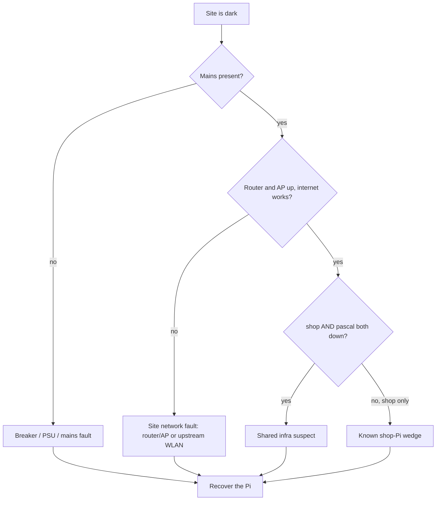

# On-Site Recovery — workshop Pi and site outage

What to do when the workshop has gone dark and you are going there in person. This is the physical counterpart to the alarm-side runbook (`github.com/uhlig-it/shop-alarm/docs/runbook.md`); the normative design is the workspace `DESIGN.md`, the dated incident history is the workspace `docs/verification-log.md`, and the reliability-dashboard semantics are in `github.com/uhlig-it/metrics/vmui-dashboards/README.markdown`.

Read this together with the "Current State" and "Recommended Next Steps" sections of the retired shop repo's `README.markdown`.

## When to use this

The alarm is `triggered` with `bridge_loss` (or the shop is simply unreachable) and the shop Pi has not come back on its own. The alarm side is already handled by the time you arrive — see "Close out the alarm" below.

## Before you leave

* Phone with Tailscale and the Home Assistant app (the alarm panel and the ACK button), plus the on-site credentials from the vault.
* A known-good 5 V PSU, a spare SD card (or a USB SSD), an Ethernet cable and a USB adapter, and a laptop.
* Nothing at the site is remotely power-cyclable: the Tasmota plugs reach MQTT *through* the shop Pi, so they die with it. This visit is the only lever.

## Step 1 — Observe before touching anything

The first question is **not** "what is wrong with the Pi" but "what is wrong with the site". A shop-Pi-only fault and a whole-site outage look identical from off-site; the difference is what you find here.

* **Mains.** Lights, sockets, the breaker/RCD panel, the Tasmota plugs' LEDs, the router/AP/switch LEDs. Photograph the state before changing anything. If the mains was out, that is the root cause — restore the breaker and continue.
* **Site network.** Is the router/AP up, and is there internet (join the site WiFi on your phone)? If the router/AP is dead, that alone explains the whole site disappearing. This is the **most likely case** for a both-boxes-down outage: on 2026-09-27 the site's upstream WLAN vanished and everything looked exactly like a dead Pi.
* **Which machines are down.** `shop` only, or `shop` **and** `pascal`? Both down together means shared infrastructure (mains or the site network), not the Pi. This is the same rule the reliability dashboard uses: *shop below pascal = the shop box itself; shop and pascal both down = WiFi or mains* (`github.com/uhlig-it/metrics/vmui-dashboards/README.markdown`).



## Step 2 — Capture evidence before rebooting

journald is in RAM (`log2ram`), so a hard power cut wipes the previous boot's journal. The only evidence that survives a power cut is `/var/lib/shop-watchdog/log` on disk. **If the Pi is reachable, read it before you power-cycle.**

```sh
journalctl -b -1 -t shop-boot-diag | tail -60
journalctl -b -1 -t shop-watchdog | tail -40
tail -50 /var/lib/shop-watchdog/log
vcgencmd get_throttled                 # 0x50000 = undervoltage happened
dmesg | grep -iE 'mmc0|brcmfmac|under-voltage|failed'
mount | grep ' / '                     # rw expected; ro = the SD-card failure mode
tailscale status                       # direct vs relay
systemctl status mediamtx mosquitto mqtt-gpio-binary-sensor
```

If the Pi is hard-off there is nothing to read — skip to Step 3.

## Step 3 — Recover the Pi

* Power-cycle (pull power for ~10 s, replug). A reboot has reliably restored this device.
* SSH in and re-run the Step 2 diagnostics; confirm the WiFi link, `/` mounted `rw`, and `tailscaled` online.
* Confirm the opus↔shop path is **`direct`, not `relay`** (`tailscale status | grep shop`). A relayed link cannot carry the camera stream and will trip `camera_loss`. If it is relayed, set `PORT="41642"` in `/etc/default/tailscaled` on **both** opus and the shop and restart `tailscaled` (workspace `DESIGN.md`, "opus↔shop Network Path").

## Step 4 — Repair and prevent

* Deploy the shop play from github.com/uhlig-it/infrastructure (playbooks/machines/shop.yml): `ansible-playbook playbook.yml`. This installs `shop-watchdog` (self-reboot on a read-only filesystem, a dead gateway, or offline Tailscale), `shop-boot-diag`, `shop-wifi-keepalive` and log2ram. It is not on the Pi yet — deploying it is step 4 of the README checklist, and the metrics repo also lists the watchdog as "committed but not deployed".
* From the README's "Recommended Next Steps": point mediamtx's HLS cache at `/dev/shm` (tmpfs), plan the move to a USB SSD, and move the Tasmota plugs to the **opus** broker directly so mains can be observed during a Pi outage.

## Step 5 — Verify from off-site before you leave

* on opus: `tailscale status | grep shop` → `direct`.
* `$SYS/broker/connection/shop.shop/state` → `1`.
* `frigate/werkstatt/status/detect` steady `online`; `werkstatt_camera_fps` > 0; a live snapshot renders.
* shop-machine dashboard: `up{shop:9100}=1`, `shop_health=1`, the plugs up.

## Step 6 — Close out the alarm

The alarm episode is silenced with `ACK` while you work (the state stays `triggered`; see the alarm runbook). Once the site is healthy and you have reviewed what you can — note there is **no footage** from the outage, the camera was gone — **disarm** to clear `triggered` and restore the privacy profile, then re-arm when you leave.

## TODO — telemetry gaps this incident exposed

Not fixed yet. These are why a whole-site outage cannot be told apart from a Pi fault from off-site, and why the camera-loss trigger did not fire.

* **Mains is invisible during a Pi outage.** The Tasmota plugs (192.168.1.10–.12) are scraped only through the shop/pascal Tailscale subnet route, so they vanish with the Pis whether or not power was up. Point them at the opus broker (or an exporter that survives the Pi) so mains is observable.
* **`camera_loss` is blind to a flapping stream.** A crash-looping stream process keeps `frigate/<cam>/status/detect` toggling, so the 30 s-continuous condition never holds and only `bridge_loss` catches the outage. Consider falling back to `camera_fps`/`camera_online` with a debounce.
* **No off-site view of the site uplink.** Everything that could report on the site (the LAN probe on `pascal`, the mains plugs) rides the shop/pascal Tailscale subnet route and dies with the uplink. Add an uplink-liveness monitor that does not depend on the site (e.g. Uptime-Kuma or a `shop-health.sh` variant run off-site with `NTFY_URL`), so a vanished upstream pages directly instead of waiting ~5 min for the alarm's `bridge_loss` escalation. Backup-uplink options: `docs/backup-uplink.md`.

## See also

* `github.com/uhlig-it/shop-alarm/docs/runbook.md` — the alarm-side operator runbook (review, `ACK` vs `DISARM`, trigger triage, the shop-offline branch).
* `docs/backup-uplink.md` — options for a diverse/backup uplink (undecided).
* `github.com/uhlig-it/metrics/vmui-dashboards/README.markdown` — the shop-vs-pascal rule and the mains plugs.
* workspace `DESIGN.md` — supervision matrix and the Tailscale path requirement.
* the retired shop repo's `README.markdown` — current state, mitigations, and the on-site checklist this document expands.
