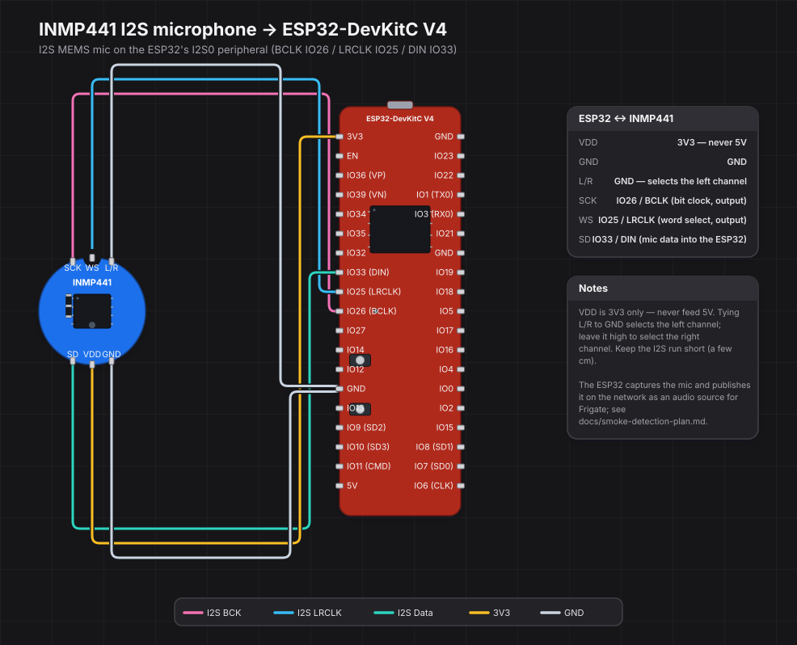

# i2s-mic

Documentation for the **INMP441 I2S MEMS microphone** used by the smoke-detection work — see [`../../docs/smoke-detection-plan.md`](../../docs/smoke-detection-plan.md).

> **Status:** the deployment path moved to standalone **ESP32 nodes**, so the Raspberry Pi boot-config role (managing `dtoverlay=googlevoicehat-soundcard` + `dtparam=audio=off` in `/boot/firmware/config.txt`) has been removed and `ha-kiosk` reverted. What remains here is the wiring diagram; role content for the ESP32 sensor node will be added later.

## Wiring diagram

The source is [`inmp441-esp32.yaml`](inmp441-esp32.yaml) — wiregen's declarative YAML. [`inmp441-esp32.svg`](inmp441-esp32.svg) is rendered from it and committed here so it shows inline on GitHub:



[`render-wiring-diagram.yml`](../../.github/workflows/render-wiring-diagram.yml) re-renders the SVG whenever the YAML changes and commits it, so the picture never drifts from the source.

To render locally, install [wiregen](https://github.com/WeebLabs/wiregen) and run:

```sh
pipx install --editable /path/to/suhlig-wiregen   # install the fork, editable
wiregen render roles/i2s-mic/inmp441-esp32.yaml --table
```

`render` validates first and refuses to write on error; `--table` also prints the from→to wiring checklist, and `--theme light` (or `carbon`, `midnight`) switches the colour scheme.

We use wiregen via the **fork until the INMP441, Raspberry Pi 3 and ESP32-DevKitC V4 parts land upstream** (`github.com/suhlig/wiregen`, branch `add-smoke-detection-via-INMP441`). There is already an unmerged `add-pcm5102A` branch on the fork, and the upstream author is responsive, so the parts are meant as contributions rather than a permanent fork. Three parts were added to the fork's library (`wiregen/parts/`):

- `inmp441` — INMP441 breakout, the common round blue PCB drawn as a circle with its alignment notch and two rows of three pads (SCK, WS, L/R and SD, VDD, GND).
- `raspberry-pi-3` — Raspberry Pi 3 Model B, the 40-pin J8 header drawn as its two physical rows (odd pins left, even pins right).
- `esp32-devkitc-v4` — Espressif ESP32-DevKitC V4 (ESP32-WROOM-32), the two 19-pin headers in physical order with the module, buttons and USB drawn in.

Confirm they load with `wiregen list-parts` / `wiregen describe-part inmp441`.

## Why wiregen

The requirement was a wiring diagram that is **text-source, diffable, and renders a real board** — the INMP441 wired to the ESP32 node, kept alongside the code that deploys the sensor. wiregen fits that exactly: a small YAML describes parts and pin-to-pin wiring, the engine owns every pixel, the part library is easy to extend, and buses collapse into one shorthand with role-coloured wires and an auto-generated checklist. It keeps the diagram in git next to the rest of the work, with no GUI round-trip and no cloud.

## Why not the alternatives

- **WireViz** produces a harness/pinout drawing, not a board picture — you describe connectors by hand and get no board likeness, so it reads as a connector table rather than "how this hooks up on the board".
- **Wokwi** does model ESP32 boards and renders a photo-real breadboard, but it is editor/cloud-first: the `diagram.json` is large and usually written back by the drag-and-drop editor, and there is no offline text-source render. A poor fit for a diffable diagram that lives in the repo.
- **Fritzing** gives the closest visual result and a large parts library, but it is GUI-first with an XML project format, so the diagram cannot live as reviewable source in the repo.

The one trade-off: wiregen is young. That is why the three parts are contributed upstream rather than vendored, and why the diagram source is kept trivial (one `bus: i2s` shorthand plus three explicit wires).
